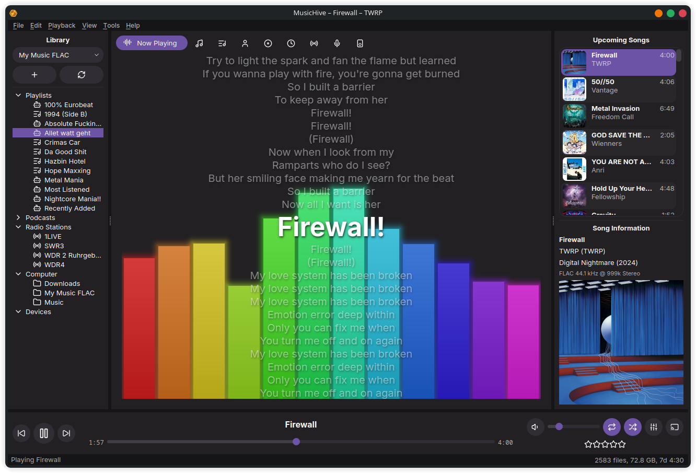
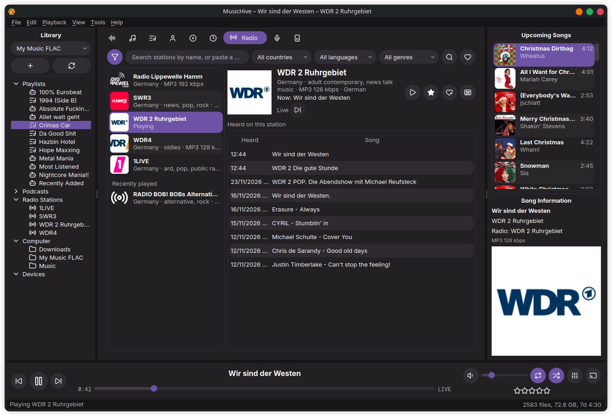
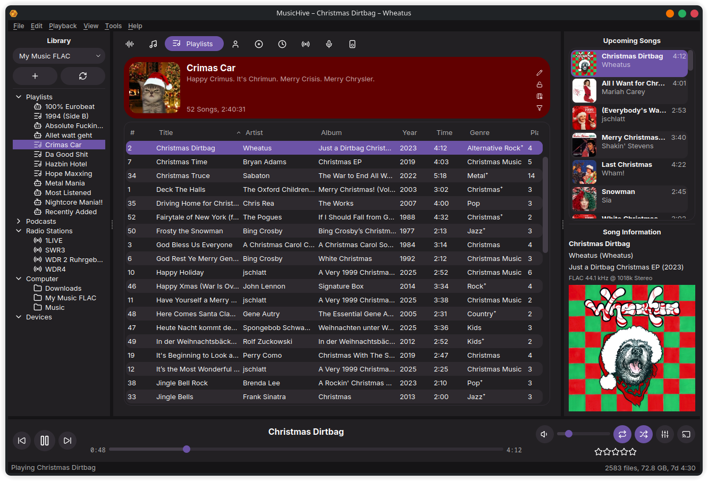
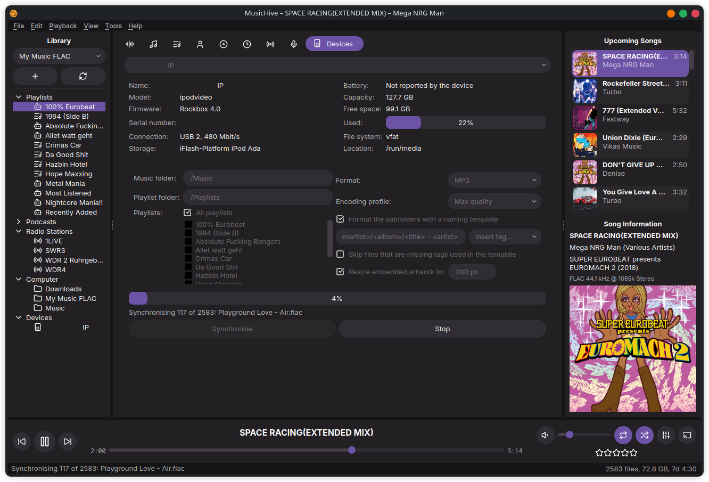

<p align="center">
  
</p>

<h1 align="center">MusicHive</h1>

<p align="center">A desktop music player for people who still keep their music in folders.</p>

MusicHive plays your local library on Linux and Windows. It has the things I wanted from a
music player: proper playlists, lyrics that follow the song, a real equaliser,
Last.fm scrobbling and syncing to a portable player (my beloved iPod lol). It's written in Python with Qt for the interface and GStreamer for the sound, and I run it on Fedora KDE
Plasma. Yes, this project is heavily inspired by [MusicBee](https://getmusicbee.com/).

<p align="center">
  
</p>

## What it does

### Your library

- Keep several libraries, each one pointing at its own folder, and switch between them from the sidebar.
- Plays MP3, FLAC, Ogg and WAV files.
- Browse by song, playlist, artist or album. The filter list next to each table can also group by album artist, genre, year or decade.
- Choose which tags the tables show, in what order, including any custom tag found in your files.
- Rate songs with stars. Ratings are written to the files, so they aren't locked inside the app.
- A History tab shows what you've been listening to.
- Artist pictures and descriptions are fetched from the internet and kept on disk.
- Start typing in any list or table to jump to a matching song, searching the sorted column first.

### Playback

- Shuffle, repeat one or repeat all, and a queue with Play next and Add to queue.
- Smart shuffle (a setting) keeps the same artist or album from playing twice in a row, while the order stays random.
- An Upcoming list that shows exactly what's coming, where you can jump ahead or remove songs.
- Stop after a chosen song.
- Crossfade between songs, optionally also when you skip. Tracks of an album that play in order can be left without a crossfade, for albums whose songs run into each other.
- Soft fades when pausing or stopping.
- Skips silence at the start and end of songs.
- Picks up where you left off, paused at the same spot in the same song. Your place is saved with every song and every 30 seconds, so it survives switching the computer off with MusicHive still open.
- Scroll over the volume icon to change the volume by 1%, or 10% with Shift held.
- A sleep timer that fades out music, podcasts and radio.
- Every action has a keyboard shortcut you can change.

### Sound

- 10 or 15 band equaliser with a pre-amp, built-in presets and your own saved ones.
- Left and right balance.
- Songs, albums and playlists can have their own equaliser preset. When a song plays from a playlist, the playlist's preset wins, unless the song is set to override it.
- Level Volume measures how loud your songs are and stores the result as standard ReplayGain tags, so a whole library plays at one volume and other players can use the numbers too.
- When an album plays in order, it can keep its own loud and quiet songs: the whole album gets one volume, from its album ReplayGain tag or worked out from its songs. Shuffled and mixed songs keep a volume of their own.

### Now Playing

- A live spectrum visualiser that follows the sound you actually hear, at up to 60 frames a second. You can set the number of bars, the gap, opacity, fall speed and glow, and colour them yourself, as a rainbow, as a pride flag, or from the album cover. The background can be a blurred copy of the cover.
- Visualiser presets, with a built-in Default. Like equaliser presets, they can be given to songs, albums and playlists.
- Pride flags are plain JSON files, so you can add your own to the `flags` folder in the data folder.
- Timed lyrics in LRC format, read from your files or from a `.lrc` file next to the song. The current line is highlighted and centred, and plain lyrics work too.
- Lyrics can have a text shadow, take a colour from the cover and grow with the window, which is nice on a TV.
- Scrolling moves one line per wheel click. After you scroll, the lyrics stay put for a few seconds before following the song again.

### Podcasts

- Search for podcasts through Apple Podcasts and subscribe to them.
- New episodes can download by themselves, and played ones can be deleted by themselves.
- Progress is remembered for each episode and shown for each series. Episodes can also be streamed without downloading.

### Radio

<p align="center">
  
</p>

- Thousands of internet radio stations from [Radio Browser](https://www.radio-browser.info), with favourites.
- Pause the radio and carry on from where you paused, or go back a few minutes in time.
- Tape a stream to a file, see a history of what played and remember songs you liked.
- Radio songs can be scrobbled to Last.fm if you want.
- Podcasts and stations can be pinned to the sidebar, and the sidebar's sections can be dragged into any order.

### Mini player

A small borderless window for when the main one is in the way. It shows the
title and artist with previous, play/pause and next buttons, a seek bar and a
volume icon you can scroll over or click to mute. The visualiser runs behind it
if you want it to, and right-clicking gives you shuffle, repeat and a way back to
the main window. It stays on top, stays out of the taskbar and remembers where
you left it.

On Wayland, those last three things depend on KDE's window manager. On other
Wayland desktops the mini player still works, but it won't stay on top or keep
its position.

### Casting

Send the music to your TV, from the cast button next to the equaliser or
Playback → Cast To…. That opens the Cast To window, which lists This Computer,
the TVs and speakers it finds and the web browser; click one to play there.
Songs, podcasts and radio all work, and going back to This Computer carries on
where the TV was. There are three ways to do it:

**Chromecasts and DLNA TVs or speakers.** MusicHive finds them on your network.
The TV shows the title, artist and cover, and the play button, seek bar and
volume in MusicHive control it. On a Chromecast, previous and next also work
from the TV, the phone notification and Google Home.

**With the visualiser and lyrics.** Turn on *Show visualiser and lyrics on the
TV* and MusicHive sends a video instead: your visualiser and the lyrics, with the
title and artist underneath. The sound goes through your equaliser, crossfade and
Level Volume, and the pictures are made together with it, so they stay in time
however long the TV buffers. Pausing and skipping take a few seconds to reach the
TV, though.

**In a web browser.** Pick *Web Browser* and open the address it shows (something
like `http://192.168.1.20:8471/482913/`) in your TV's browser, or any other
browser on your network. This is the nicest way to have the visualiser and lyrics
on a TV:

- The page plays the music itself and draws your visualiser and the lyrics at the
  TV's own resolution, in your colours and style, with the title, artist, cover
  and a progress bar.
- MusicHive works out each song's bars in advance (the next song while one plays),
  so the visualiser runs from the very first moment, and the TV doesn't have to
  do any of the work.
- Previous, play/pause and next buttons on the page work with the TV remote's
  arrows and OK, and with its media keys. They do the same as MusicHive's own
  buttons, so shuffle and the queue still decide what comes next.
- Level Volume applies on the page too, and the volume slider controls the page
  while you're casting.
- The address stays the same, so you can bookmark it. The browser asks for one
  press of OK before it plays sound.

The TV fetches the music from MusicHive itself, over ports 8471 to 8480. On
Fedora that works out of the box; with a stricter firewall, let those ports
through for your home network. Windows asks once whether MusicHive may use the
network: allow it for private networks. MusicHive only listens there while you're
casting, and only answers the device you're casting to (or, for the browser page,
whoever has its address). Chromecasts need the PyChromecast package; DLNA TVs need
an H.264 encoder such as openh264 for the video mode; the browser page needs
nothing extra. The AppImage and the Windows version have all of that built in.

### Subsonic and octo-fiesta

Connect MusicHive to your own Subsonic server, such as Navidrome, in Settings →
Subsonic, and search it from the Subsonic tab. With
[octo-fiesta](https://github.com/V1ck3s/octo-fiesta) in front of the server, a
search also finds songs on Deezer, Qobuz and other services; those are marked
"from Deezer" and so on.

- **Download on Server** has the server download songs or whole albums into
  octo-fiesta's folder. Whether one song or its whole album comes down is
  octo-fiesta's own setting. Nothing is saved on your computer.
- **Download and Play** plays a song straight from the server. When it ends, or
  you press Next, the library carries on where it was.
- **Import to Library** copies songs from the server into the open library,
  named with the Organise Files template, and adds them without a rescan. If
  you want (two tickboxes in Settings → Subsonic), each one's volume is levelled
  and its lyrics are looked up on the way in, as Level Volume and Find Lyrics do.
- Party guests can search the server too (a setting). Their song is imported,
  tagged `guestdownload=true` so you can find those later, and queued with their
  name.

The password is kept in the secrets file, not with the other settings, so it
isn't part of a settings export. MusicHive logs in with Subsonic's token login,
so the password itself never travels over the network.

### Party Mode

Let your friends pick the music. Playback → Party Mode shows a QR code with the
MusicHive logo in the middle; guests on the same Wi-Fi scan it with their phone
camera, type their name once and get a page where they can:

- see what's playing and what's coming up,
- search your library and add songs to the queue,
- vote to skip the playing song. It's skipped once more than half of the guests
  vote for it, and you can turn voting off.

Their songs show up in your Upcoming list with "added by" and their name, and
you can move or remove them like any other. While you cast to a web browser or
with the visualiser and lyrics, the TV shows who added the song too, and *Show on
TV* puts the QR code in a corner of the TV so people can join from there. The
browser page also gets a QR button next to play and pause. The page uses the same ports as
casting (8471 to 8480), and the address stops working when you end the party.

### Playlists

<p align="center">
  
</p>

- Normal playlists with their own image and description. Animated GIFs work as playlist images.
- The box behind a playlist's, artist's or album's header takes its colour from the picture. A playlist can have a colour of your own instead.
- Auto-playlists that fill themselves from rules such as "Genre contains Rock", "Year is greater than 1999" or a play count. A new one starts with every song.
- Import and export M3U and M3U8 files.
- Drag songs between lists. Hold a song over a tab and that tab opens.

### Tags and file tools

- A tag editor for one song or many at once. When editing several songs, a field they disagree on stays empty and is only written if you type in it, so nothing changes by accident.
- Find album covers, genres and lyrics online. Nothing is saved until you've approved it in a side by side comparison.
- Auto-Tag Genres does the same for a whole set of songs, and lyrics can be found for many songs at once. Instrumentals get tagged `haslyrics=false` so they aren't searched again.
- Check Covers lists albums whose cover is missing, unreadable, not square, too small, a very big file, or not the same for every song. It shows an album's different covers side by side, can stretch one to a square or give it to the whole album, and opens the tag editor with the cover search already running.
- Check Tags lists songs with missing tags, albums with duplicate or missing track numbers or songs that disagree on the year or album artist, and artists written more than one way ("The Beatles" and "Beatles"). It can make a tag the same for a whole album and number an album's tracks again.
- From Check Tags, albums can be looked up on [MusicBrainz](https://musicbrainz.org), one at a time or the whole list in a row. You see every tag it would change next to what the songs have now and tick the ones you want, and dates can be written as just the year. No account is needed.
- Find Duplicates finds songs that are in the library more than once, with their format, size, plays and rating side by side, so you can listen to each and keep the best. The others go to the Trash, and their plays, rating and places in playlists pass to the one you keep.
- Albums, songs or artists that are fine as they are can be marked to skip in each of these checks. The mark is a tag in the files, so it stays with them.
- Edit → Tag Change History lists the last 50 times tags were saved, from the tag editor, these tools, MusicBrainz or the genre and lyrics searches, and can undo any of them. An undo can be undone again.
- Organise Files moves a library into a folder structure from a naming template like `<albumartist>/<album>/<trackno> - <title>`.
- Convert Files makes copies in MP3, Ogg Vorbis, Opus or FLAC.

### Devices

<p align="center">
  
</p>

Plug in a USB drive, an iPod or anything else that shows up as storage and
MusicHive can sync a library to it. It can keep the original files or convert
them with a quality profile, rename folders with a template, shrink embedded
artwork and copy your playlists across. Before it deletes anything from the
device, it shows you exactly which files would go.

Rockbox players get some extra attention: the device details show up in the
Devices tab, and the plays in a `.scrobbler.log` can be sent to Last.fm. Last.fm
limits how many scrobbles it accepts in a day, so a big log goes out a day's worth
at a time.

On Windows, MusicHive lists drives that Windows calls removable (USB sticks and
most music players; some external hard drives count as fixed and don't show up).
It can't read the hardware details or battery there, only what a Rockbox player
writes about itself.

### Connected to your desktop

- Last.fm scrobbling, now playing updates, and downloading your play counts.
- Discord Rich Presence with the album cover.
- MPRIS support, so desktop widgets and media keys can see and control it (Linux only).
- A tray icon, minimizing to the tray and starting hidden in the tray.

### Small things

- Dark and light mode, with a highlight colour of your choice.
- Settings can be exported to a file and imported again.
- The data folder can be moved somewhere else.
- Some small easter eggs for you to find. :)

## Installing

Each [release](https://github.com/music-hive-dev/MusicHive/releases) has ready-made
packages: an RPM for Fedora, a `.deb` for Debian and Ubuntu, an Arch package, an
AppImage and a Windows installer. The sections below also show how to build each of
them yourself.

### Fedora

Build the RPM from a clone of this repository:

```
sudo dnf install rpm-build python3-devel
./packaging/build-rpm.sh
```

The package ends up in `dist/`, built from the latest commit. Install it with:

```
sudo dnf install ./dist/musichive-*.noarch.rpm
```

`dnf` brings in everything else it needs, and MusicHive then shows up in your
application menu. The package is built for the Fedora release you build it on.

### Debian and Ubuntu

The `.deb` needs `dpkg-deb`, which Debian-based systems already have (on Fedora,
install `dpkg`):

```
./packaging/build-deb.sh
sudo apt install ./dist/musichive_*_all.deb
```

It needs a release that packages PySide6, such as Debian 13 or Ubuntu 24.10 and
later.

### Arch Linux

On Arch the script uses `makepkg`. On any other distribution it builds inside an
Arch Linux container, so you only need `podman`:

```
./packaging/build-arch.sh
sudo pacman -U ./dist/musichive-*-any.pkg.tar.zst
```

### AppImage

The AppImage carries its own Python, Qt and GStreamer, so it runs without
installing anything. It's built inside a Debian 12 container with `podman`:

```
./packaging/build-appimage.sh
./dist/MusicHive-*-x86_64.AppImage
```

It runs on 64-bit PCs with a distribution at least as new as Debian 12 (Fedora
37, Ubuntu 23.04 and Arch all qualify). Unlike the packages, it doesn't add
MusicHive to your application menu by itself.

### Windows

Each release has a Windows installer (`MusicHive-*-windows-x64-setup.exe`) and a
portable zip for 64-bit Windows 10 and 11. Like the AppImage, they carry their own
Python, Qt and GStreamer, but only the parts MusicHive uses. The installer isn't
signed, so Windows warns about it the first time: choose *More info*, then *Run
anyway*.

They're built on GitHub Actions with MSYS2 and PyInstaller. To
build one yourself, run this in an [MSYS2](https://www.msys2.org) UCRT64 shell (the
installer also needs [Inno Setup 6](https://jrsoftware.org/isinfo.php)):

```
./packaging/windows/build.sh
```

Differences from Linux:

- Media keys and desktop widgets don't work, as they go through MPRIS, which
  Windows doesn't have.
- Show in File Manager and opening a device use Explorer.
- The first start takes a little longer while GStreamer looks at its plugins.
- If MusicHive doesn't start, `MusicHive-debug.exe` next to it shows what goes
  wrong in a console window, and `%LOCALAPPDATA%\MusicHive\musichive.log` keeps
  what it printed the last time it ran.

## Running from source

On Fedora, the libraries are all available as system packages:

```
sudo dnf install python3-pyside6 python3-mutagen python3-gobject \
    gstreamer1-plugins-good gstreamer1-plugins-bad-free rsms-inter-fonts \
    python3-pychromecast
python3 main.py
```

On another distribution you'll need the equivalent packages. Python 3 with
PySide6, Mutagen and PyGObject, plus GStreamer and its good plugins, should be
enough. The interface uses the Inter font if it's installed, and PyChromecast
is only needed for casting to Chromecasts.

## Translating

MusicHive is written in English and can be translated into other languages. The
language is chosen in Settings → Interface → Language; "System default" uses the
desktop's language when there is a translation for it.

To start a translation, run `translations/update.sh` with the language's code,
for example `translations/update.sh de` for German. This makes
`translations/musichive_de.ts`, with every text of the program in it. Translate
it in Qt Linguist (`pyside6-linguist translations/musichive_de.ts`), then run
`translations/update.sh` again: it brings every translation up to date with the
code and makes the `.qm` files MusicHive reads. Restart MusicHive to see the
changes.

A few things to keep in mind:

- Words in braces, like `{name}` or `{count}`, are filled in by the program. Keep
  them as they are, wherever they belong in the sentence.
- Texts with `%n` have a form for each plural: "%n song(s)" becomes "1 song" and
  "2 songs" in English. Qt Linguist shows a field for each form your language has.
- Texts that are not translated yet are shown in English.

When the code changes, add texts with `tr("...")` (from `src/i18n.py`), never with
an f-string inside it: `tr("Saved {name}").format(name=name)`, so that
`update.sh` can find them. Texts in the `.ui` files are found automatically.

## Making a release

GitHub builds every package after each push to `master` (Actions → Build, under
Artifacts). To publish a release, raise the version in `packaging/musichive.spec`,
add a `%changelog` entry, then push a tag with that version:

```
git tag 1.6.9
git push origin 1.6.9
```

GitHub then builds all packages and makes the release, with the changelog entries
since the previous release as its text.

## Last.fm setup

Last.fm needs an API key, which isn't included in this repository. Get one from
Last.fm, then put it in `~/Music/.musichive/secrets` (Settings, Online has a
button that opens this file):

```json
{
  "lastfm_api_key": "your key",
  "lastfm_api_secret": "your secret"
}
```

Restart MusicHive and log in from the Last.fm window.

## Where your data lives

Libraries, playlists and cached images are kept in `~/Music/.musichive`
(`%USERPROFILE%\Music\.musichive` on Windows), unless you've moved that folder in
the settings. Other settings are in `~/.config/MusicHive`, and on Windows in the
registry under `HKEY_CURRENT_USER\Software\MusicHive`. Uninstalling the app leaves
all of them alone.

MusicHive is a local player, but a few features do use the internet. Artist
pictures and album searches go to Deezer and iTunes, artist descriptions come
from Last.fm, lyrics come from
[LRCLIB](https://lrclib.net), album details for Check Tags from
[MusicBrainz](https://musicbrainz.org), podcasts from Apple Podcasts and radio stations from
Radio Browser, and Last.fm gets your plays if you've turned scrobbling on.
Discord can only show images that are online, so with Rich Presence on, the cover
of the current song is uploaded to a file host:
[Litterbox](https://litterbox.catbox.moe), with [Catbox](https://catbox.moe) and
[Uguu](https://uguu.se) as fallbacks.

## Built with

- [PySide6](https://doc.qt.io/qtforpython-6/) (Qt for Python), LGPL-3.0
- [GStreamer](https://gstreamer.freedesktop.org/), LGPL-2.1
- [PyGObject](https://pygobject.gnome.org/), LGPL-2.1
- [Mutagen](https://mutagen.readthedocs.io/), GPL-2.0-or-later
- [PyChromecast](https://github.com/home-assistant-libs/pychromecast), MIT License
- Icons from [Lucide](https://lucide.dev/), ISC License, some derived from Feather, MIT License
- Emoji from [Twemoji](https://github.com/twitter/twemoji), CC BY 4.0, in the Twemoji Mozilla font
- Album data from [MusicBrainz](https://musicbrainz.org), CC0 (public domain)
- The [Inter](https://rsms.me/inter/) font, SIL Open Font License 1.1, included in the Windows version

## Licence

MusicHive is free software: you can use it, change it and share it under the
[GNU General Public License](LICENSE), version 3 or (at your option) any later
version. It comes with no warranty.
